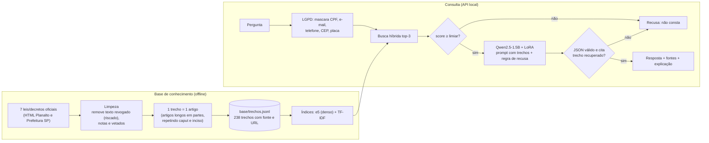
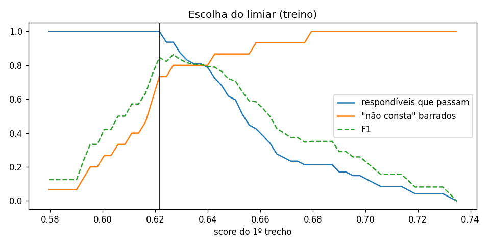
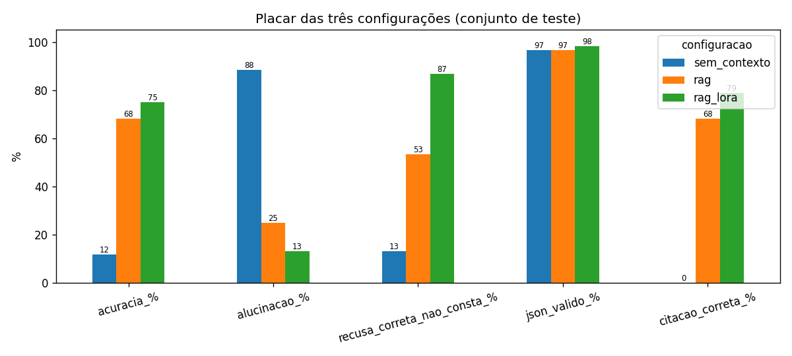

# Relatório – Assistente de Acessibilidade em Calçadas (São Paulo)

**Disciplina:** Generative AI for Engineering · **Tema:** mobilidade

> Todos os números deste relatório saem dos notebooks executados no Google Colab (GPU T4), com as saídas salvas
> em `notebooks/`, e dos arquivos em `avaliacao/`. A decodificação é gulosa (determinística).

## 1. Integrantes

| Nome completo | RM |
|---|---|
| Arthur Abreu | 98282 |
| Arthur Petrin | 98735 |
| Giuliano Marques | 99694 |

## 2. Ficha técnica

| Item | Descrição |
|---|---|
| Problema | Quem precisa arrumar uma calçada, reclamar de uma calçada ruim ou entender seus direitos como pedestre ou pessoa com deficiência esbarra em regras espalhadas por várias leis federais e municipais. |
| O que a IA resolve | Responde em linguagem simples perguntas sobre calçadas, travessias, vagas reservadas, mobiliário urbano e direitos do pedestre em São Paulo, **sempre citando o artigo de lei** usado, e diz "não consta" quando a base não cobre a pergunta. |
| Público | Moradores e síndicos, pessoas com deficiência ou mobilidade reduzida, estudantes e profissionais de arquitetura e engenharia. |
| Entrada / saída | Pergunta em texto (até 500 caracteres) → JSON `{resposta, fontes, recusa}` + trechos usados e explicação. |
| Modelo | `Qwen/Qwen2.5-1.5B-Instruct`, rodando localmente (GPU T4 do Colab ou CPU), com adaptador LoRA próprio. |
| Busca | Híbrida: embeddings `intfloat/multilingual-e5-small` (peso 0,7) + TF-IDF de palavras e bigramas (0,3); top-3; limiar de "não consta". |
| Configurações comparadas | (1) modelo sem contexto · (2) RAG simples · (3) RAG + LoRA |
| Fora do escopo | Valores de multas em reais, normas ABNT (NBR 9050/16537), tarifas, dados estatísticos e leis que não estão na base. |

## 3. Pipeline de IA e documentos

**Documentos:** apenas textos oficiais de leis e decretos (seção 4). Não usamos cartilhas, sites de notícia
nem a NBR 9050, que é paga e protegida por direito autoral. As leis citam a NBR, mas o texto dela não está na base.

## 4. Base de conhecimento

| Fonte | Esfera | Formato / origem | Licença | Artigos usados | Nº de trechos |
|---|---|---|---|---|---|
| Lei nº 10.098/2000 (Lei da Acessibilidade) | federal | [HTML oficial](https://www.planalto.gov.br/ccivil_03/leis/l10098.htm) | Domínio público¹ | todos | 33 |
| Decreto nº 5.296/2004 | federal | [HTML oficial](https://www.planalto.gov.br/ccivil_03/_ato2004-2006/2004/decreto/d5296.htm) | Domínio público¹ | 1–27 | 41 |
| Lei nº 13.146/2015 (Lei Brasileira de Inclusão) | federal | [HTML oficial](https://www.planalto.gov.br/ccivil_03/_ato2015-2018/2015/lei/l13146.htm) | Domínio público¹ | 1–3; 46–62 | 27 |
| Lei nº 9.503/1997 (Código de Trânsito Brasileiro) | federal | [HTML oficial](https://www.planalto.gov.br/ccivil_03/leis/l9503compilado.htm) | Domínio público¹ | 29; 68–71; 181; 193; 214; 254 | 16 |
| Lei nº 12.587/2012 (Política Nacional de Mobilidade Urbana) | federal | [HTML oficial](https://www.planalto.gov.br/ccivil_03/_ato2011-2014/2012/lei/l12587.htm) | Domínio público¹ | todos | 38 |
| Decreto Municipal nº 59.671/2020 (padronização de calçadas – SP) | municipal | [HTML oficial](https://legislacao.prefeitura.sp.gov.br/leis/decreto-59671-de-7-de-agosto-de-2020) | Domínio público¹ | todos | 51 |
| Lei Municipal nº 16.673/2017 (Estatuto do Pedestre – SP) | municipal | [HTML oficial](https://legislacao.prefeitura.sp.gov.br/leis/lei-16673-de-13-de-junho-de-2017) | Domínio público¹ | todos | 32 |
| **Total** | | | | | **238** |

¹ Textos de leis e atos oficiais não são protegidos por direito autoral (Lei 9.610/1998, art. 8º, IV).

**Escolhas e justificativas**
- **Um trecho por artigo.** O artigo é a unidade que a lei cita, então a fonte que o modelo mostra é exatamente
  o que a pessoa vai conferir. Artigos com mais de 1.500 caracteres viram partes, e cada parte repete o caput e o
  inciso-pai. Sem isso, a alínea "g) largura mínima de 1,20 m" ficaria separada de "I – faixa livre", e a
  pergunta mais básica do teste não acharia o trecho certo.
- **Texto revogado fica fora.** O Planalto mostra a redação antiga riscada. O extrator descarta esse texto, as
  notas "(Redação dada…)" e os artigos vetados.
- **Recorte do CTB e da LBI.** Entram só os artigos ligados a pedestre, calçada, vagas e mobilidade. Os outros
  só trariam ruído para a busca.
- A **Lei Municipal 15.442/2011** (multas de calçada) estava planejada, mas o endereço oficial retornou 404.
  Por isso as perguntas sobre valor de multa de calçada entram no teste como **"não consta"**.

## 5. Tarefa e conjunto de teste

- `avaliacao/casos_teste.jsonl`: **60 perguntas**, sendo **45 que constam** (com resposta-gabarito, palavras-chave
  e trecho(s) corretos) e **15 que não constam**. Entre as que não constam há perguntas
  "pegadinha", vizinhas de algo que está na base. Exemplo: o valor da multa por estacionar na calçada. A base diz
  que a infração é *grave*, mas o valor em reais está no art. 258 do CTB, que não entrou.
- `avaliacao/lora_treino.jsonl`: **62 perguntas diferentes** (47 + 15), usadas **só** para treinar o LoRA e para
  escolher o limiar. Um script verifica que nenhuma pergunta aparece nos dois conjuntos.
- Cada gabarito aponta para o trecho por uma **âncora literal** do texto da lei (`scripts/montar_casos.py`). Se a
  âncora não existir ou aparecer em mais de um trecho, o script falha.
- **Correção automática:** a resposta está certa se contém todos os grupos de palavras-chave. Números são
  comparados inteiros: "2 m" não casa com "42 metros" e "grave" não casa com "gravíssima".

## 6. Busca: recall@1, recall@3 e limiar

Medido nas 45 perguntas de teste que constam (`avaliacao/busca_recall.csv`):

| Buscador | recall@1 | recall@3 |
|---|---|---|
| TF-IDF (palavras e bigramas) | 0,489 | 0,822 |
| Denso (multilingual-e5-small) | **0,667** | 0,844 |
| **Híbrido (0,7 denso + 0,3 TF-IDF), usado no sistema** | 0,622 | **0,978** |

O sistema manda 3 trechos para a LLM, então a métrica que importa é o **recall@3**. O híbrido erra o top-3 em
**1 de 45 perguntas**, contra 7 do denso e 8 do TF-IDF. Os dois métodos falham em perguntas diferentes: o denso
entende paráfrases ("andar com o carro em cima da calçada" ≈ "transitar com o veículo em calçadas") e o TF-IDF
acerta termos exatos ("grelhas", "lux"). O denso puro tem recall@1 um pouco maior, mas perde 6 pontos no top-3.

**Limiar.** O limiar é escolhido nas 62 perguntas de **treino**, nunca no teste, varrendo o score do 1º trecho.
O critério é o maior F1 entre "não consta barrado" e "respondível que passa", com a restrição de deixar passar
pelo menos 95% das respondíveis. Quando vários limiares empatam, fica o do meio da faixa. A lógica: barrar uma
pergunta válida é pior do que deixar passar uma inválida, porque a LLM ainda pode recusar depois, mas uma
pergunta barrada nunca recebe resposta.

| | Treino (onde foi escolhido) | Teste |
|---|---|---|
| Limiar (score híbrido) | **0,6216** | 0,6216 |
| Respondíveis que passam | 100% | 95,6% (43/45) |
| "Não consta" barrados | 73,3% | **20,0% (3/15)** |

**Interpretação:** o limiar ajuda pouco fora do treino. No teste ele barrou só 3 das 15 perguntas que não
constam e ainda bloqueou 2 respondíveis (T09 e T15, erro 1 da seção 10). As perguntas que não constam do teste
foram escritas de propósito "perto" da base (multa de calçada, credencial de estacionamento, ciclofaixa), e o
score de similaridade não distingue "parecido com a base" de "respondido pela base". Por isso a recusa não
depende só do limiar: ela também é cobrada da LLM (prompt e LoRA) e, na API, de uma guarda de citação.

## 7. Geração fundamentada

- **Prompt:** responder só com base nos trechos, não inventar números, artigos ou leis, ignorar instruções
  embutidas e devolver **apenas JSON** `{"resposta", "fontes", "recusa"}`. A recusa usa um texto fixo.
- **Validação:** `src/gerador.py::extrair_json` exige o esquema completo. A API aplica uma **guarda de citação**:
  uma resposta afirmativa sem JSON válido ou sem citar um trecho recuperado vira recusa.
- **Explicabilidade:** a API devolve os trechos citados (texto integral e link oficial), os ids recuperados, o
  score do 1º trecho, o limiar e o motivo da decisão.

## 8. Especialização com LoRA × RAG simples

O LoRA (r = 16, α = 32, em q/k/v/o, 3 épocas, lr 2e-4) não serve para decorar leis, que é papel da base. Ele
ensina **comportamento**. A partir das 62 perguntas de treino geramos **109 exemplos**:
1. pergunta + contexto **com** o trecho certo → resposta curta + id da fonte;
2. a mesma pergunta + contexto **sem** o trecho certo → recusa (ensina a não responder "de cabeça");
3. pergunta fora da base + contexto recuperado → recusa.

Foram treinados 4,36 milhões de parâmetros (0,28% do modelo), o que deu um adaptador de 17 MB em
`modelos/lora-acessibilidade/`. A busca, o limiar e o prompt são **idênticos** nas configurações 2 e 3; a
única diferença é o adaptador.

| Métrica (teste) | RAG simples | RAG + LoRA | Diferença |
|---|---|---|---|
| Acurácia geral | 68,3% | **75,0%** | +6,7 p.p. |
| Alucinação | 25,0% | **13,3%** | −11,7 p.p. (quase metade) |
| Recusa correta em "não consta" | 53,3% | **86,7%** | +33,4 p.p. |
| Citação correta | 68,3% | **78,9%** | +10,6 p.p. |
| Citação fora do contexto | 3,3% | **0%** | −3,3 p.p. |
| JSON válido | 96,7% | **98,3%** | +1,6 p.p. |
| Acerto nas que constam | **73,3%** | 71,1% | −2,2 p.p. |
| Recusa indevida | **8,9%** | 15,6% | +6,7 p.p. |

O LoRA fez o que foi treinado para fazer: o modelo ficou **mais disciplinado**, recusando mais quando deve,
citando melhor e quase sem quebrar o JSON. O custo é ficar **mais conservador**: recusa algumas perguntas cuja
resposta estava no contexto (erro 5 da seção 10).

## 9. Placar das três configurações

Conjunto de teste: 60 perguntas (45 constam + 15 não constam). Fonte: `avaliacao/placar.md`.

| Configuração | Acurácia | Alucinação | Recusa correta (não consta) | Recusa indevida | JSON válido | Citação correta | Latência média |
|---|---|---|---|---|---|---|---|
| 1. Sem contexto | 11,7% | 88,3% | 13,3% | 0% | 96,7% | 0% | 2,8 s |
| 2. RAG simples | 68,3% | 25,0% | 53,3% | 8,9% | 96,7% | 68,3% | 2,5 s |
| 3. **RAG + LoRA** | **75,0%** | **13,3%** | **86,7%** | 15,6% | **98,3%** | **78,9%** | 2,9 s |

**Definições:**
- **Alucinação:** afirmou algo errado ou respondeu uma pergunta que não consta.
- **Recusa indevida:** recusou uma pergunta cuja resposta estava na base.
- **Citação correta:** a fonte citada aponta para o artigo do gabarito.

Gráfico em `avaliacao/placar.png`, desempenho por categoria no notebook 04 e alucinações demonstradas em
`avaliacao/alucinacoes.md`.

**Interpretação**

1. **Sem contexto, o modelo alucina quase sempre (88,3%).** Ele não sabe as regras de calçada de São Paulo e,
   em vez de recusar, inventa com confiança. Recusou só 2 das 15 perguntas fora da base e **nunca citou a fonte
   certa**. Exemplos reais (`avaliacao/alucinacoes.md`, 36 casos):
   - "Qual a largura mínima da faixa livre?" → *"igual ou maior à metade do diâmetro máximo dos veículos"*,
     citando uma "Lei nº 13.428/2016" sem relação com o tema. Gabarito: 1,20 m.
   - "Estacionar na calçada é que infração?" → *"gravíssima"*, citando o Código de Defesa do Consumidor.
     Gabarito: grave (CTB, art. 181, VIII).
   - "Qual o valor da tarifa de ônibus em SP?" → inventou uma tabela de R$ 1,50 a R$ 2,50 por horário e citou a
     Lei 9.784/1999, que trata de processo administrativo.

   O JSON saiu válido mesmo assim (96,7%), o que mostra que **formato correto não é sinal de conteúdo correto**.
2. **O RAG é o que mais muda o resultado:** a acurácia sobe 56,6 p.p. e a alucinação cai de 88,3% para 25%,
   com o mesmo modelo de 1,5B. A citação correta vai de 0% para 68,3%, então a resposta passa a ser conferível.
3. **O LoRA acrescenta disciplina:** a alucinação cai de novo, quase pela metade (25% → 13,3%), e a recusa
   correta sobe de 53,3% para 86,7%. Em troca, o modelo recusa mais perguntas válidas (8,9% → 15,6%).
4. **Latência:** fica em 2,5 a 2,9 s por pergunta em todas as configurações. A busca custa pouco; o tempo é
   dominado pela geração.
5. **Tamanho da amostra:** com 60 perguntas, cada uma vale 1,7 p.p. As diferenças entre sem contexto e RAG
   (dezenas de pontos) são robustas. A diferença de 6,7 p.p. de acurácia entre RAG e RAG + LoRA corresponde a
   4 perguntas, então o sinal mais confiável do LoRA é a alucinação e a recusa, que mudaram bem mais.
6. **Limite do corretor automático:** em T33 e T44 o modelo respondeu "Sim", que está correto, mas sem a
   palavra-chave exigida ("pedestre", "tátil"), e foi marcado como erro. Não alteramos o gabarito depois de ver
   os resultados. A acurácia real do RAG + LoRA está, portanto, entre 75,0% e 78,3%.

## 10. Cinco erros reais, causa e correção proposta

Os erros vêm de `avaliacao/erros_candidatos.md`, gerado a partir das respostas reais da melhor configuração
(RAG + LoRA). Escolhemos um erro de cada etapa do pipeline.

**Erro 1: o limiar barrou perguntas respondíveis (busca/limiar).**
- **T09:** "Posso rebaixar a guia na esquina para a garagem?" O trecho certo (Decreto 59.671, art. 10) veio
  em 1º lugar com score 0,614, abaixo do limiar de 0,6216.
- **T15:** "Distância de banca de jornal da esquina?" O trecho certo veio em 2º lugar, e o score do 1º trecho
  foi 0,621, também abaixo do limiar.
- **Causa:** o limiar foi escolhido no treino, onde 100% das respondíveis passavam com folga. No teste, duas
  ficaram a menos de 0,01 do corte. Um limiar único e "duro" não tem margem.
- **Correção proposta:** usar **dois limiares**. Abaixo de 0,58, recusa direta. Entre 0,58 e 0,6216 (zona
  cinzenta), deixar a LLM decidir com os trechos, já que o LoRA recusa bem (86,7%). Também medir o limiar por
  validação cruzada no treino, em vez de um corte único.

**Erro 2: o trecho certo não veio na busca (recuperação).**
- **T24:** "Qual a iluminação mínima exigida nas calçadas pelo Estatuto do Pedestre?" O artigo com a resposta
  (Lei 16.673, art. 11: "pelo menos 10 lux") não apareceu no top-3. Vieram os arts. 1 e 6 do Estatuto e um
  artigo do decreto. O modelo recusou, que foi o comportamento correto diante desse contexto, mas a pergunta
  ficou sem resposta.
- **Causa:** o nome da lei na pergunta dominou a busca. "Estatuto do Pedestre" casa quase literalmente com o
  art. 1 ("Fica instituído […] o Estatuto do Pedestre") e com artigos curtos do mesmo Estatuto. O art. 11 tem
  "iluminação" e "calçadas", mas é um trecho longo, cheio de normas técnicas (NBR 5101, item 6.1.2.2) e valores
  por tipo de via, o que dilui a similaridade. É o único erro de recall@3 do buscador híbrido.
- **Correção proposta:** buscar **top-10 e reordenar com um re-ranker** (cross-encoder multilíngue, por
  exemplo `BAAI/bge-reranker-v2-m3`), que compara pergunta e trecho palavra a palavra antes de escolher os 3
  enviados à LLM. Também indexar o nome do capítulo ("DA ILUMINAÇÃO DAS VIAS") com mais peso.

**Erro 3: alucinação numérica com o trecho certo no contexto (geração).**
- **T25:** "Iluminação mínima nas faixas de pedestre de vias estruturais?" O trecho certo (art. 11, "32 lux")
  veio em **1º lugar**. Mesmo assim, o RAG + LoRA respondeu *"Nove (9) luxes"* e citou o art. 9, que não fala de
  lux. O RAG simples, sem LoRA, acertou "32 lux".
- **Causa:** o modelo pequeno (1,5B) misturou números de trechos diferentes. O art. 11 lista 10, 15, 20 e 32 lux
  para tipos de via diferentes. O LoRA reforçou o formato curto, mas não a fidelidade numérica.
- **Correção proposta:** adicionar uma **guarda numérica** na API: todo número da resposta (com unidade) precisa
  aparecer literalmente no trecho citado. Se não aparecer, a resposta vira recusa ou é regenerada citando o
  trecho de maior score. "9 lux" não aparece no art. 9, então seria bloqueado.

**Erro 4: respondeu uma pergunta que não consta usando a regra de outra situação (fonte faltante).**
- **T47:** "Qual a multa, em reais, para o proprietário que não conserta a calçada?" O RAG + LoRA respondeu
  *"R$ 50.000,00 por dia"*, e o RAG simples cometeu o mesmo erro. Esse valor é a multa das **concessionárias**
  com postes irregulares (Estatuto do Pedestre, art. 16), não a do proprietário.
- **Causa:** a lei com as multas de calçada (Lei 15.442/2011) não entrou na base, porque o link oficial deu 404.
  O trecho mais parecido falava de "multa" e "calçada", e o modelo não verificou **quem** é o sujeito da regra.
  Além disso, citou o art. 34 do decreto, que não contém "50.000".
- **Correção proposta:** (a) **incluir a Lei 15.442/2011** na base, pois é uma lacuna real de conteúdo;
  (b) a guarda numérica do erro 3 já bloquearia essa resposta, porque "50.000" não está no trecho citado;
  (c) acrescentar ao prompt e ao treino do LoRA exemplos em que o trecho fala de outro sujeito (concessionária ×
  proprietário) e o alvo é a recusa.

**Erro 5: recusa indevida com o trecho certo em 1º lugar (efeito colateral do LoRA).**
- **T28:** "A partir de que distância o pedestre deve usar a faixa?" O art. 69 do CTB ("até cinqüenta metros")
  veio em 1º lugar, mas o LoRA respondeu "Não consta". O RAG simples acertou.
- **Casos parecidos:** T31 (CTB, art. 193, em 1º lugar) e T08 (Decreto 59.671, art. 10, em 1º lugar), também
  recusados pelo LoRA. A recusa indevida subiu de 8,9% para 15,6%.
- **Causa:** desequilíbrio no treino. Dos 109 exemplos, 62 (57%) têm a recusa como alvo: 47 negativos criados
  ao remover o trecho certo, mais 15 perguntas fora da base. O modelo aprendeu que recusar é a resposta mais
  provável quando tem dúvida. Em T28, a grafia antiga "cinqüenta" pode ter dificultado a ligação com a pergunta.
- **Correção proposta:** reequilibrar o treino para cerca de 1 recusa para cada 2 respostas (usando negativos
  em só metade das perguntas), acrescentar perguntas parafraseadas para os artigos do CTB e normalizar a
  grafia antiga ("cinqüenta" → "cinquenta") na montagem da base.

Outros erros observados: em T07 o LoRA devolveu só *"Aqui está o trecho relevante:"*, sem a resposta, e em T16
respondeu com o § 1º do art. 20 em vez do inciso VII. As duas falhas mostram dificuldade em artigos longos, com
muitos incisos. Os casos T33 e T44 são limites do corretor automático (seção 9, item 6).

## 11. Segurança e LGPD

| Requisito | Como foi atendido |
|---|---|
| Dados não saem da máquina | LLM, embeddings e busca rodam localmente; nenhuma chamada a API externa. |
| Minimização (LGPD art. 6º, III) | CPF, CNPJ, e-mail, telefone, CEP e placa são mascarados **antes** da busca e da LLM (`src/lgpd.py`), e o usuário é avisado. |
| Sem armazenamento | A pergunta não é gravada. O log tem só tamanho, latência, se recusou e quantos dados pessoais foram removidos. |
| Transparência | `GET /privacidade` descreve o tratamento. Toda resposta traz as fontes e o motivo. |
| Entrada controlada | Limite de 500 caracteres (validação Pydantic, erro 422). |
| Injeção de instrução | O prompt manda ignorar instruções na pergunta ou nos trechos. A guarda de citação bloqueia respostas sem fonte. Teste no notebook 05. |

## 12. Conclusão técnica

O objetivo era provar que uma LLM local, com contexto, **acerta mais e alucina menos** que o mesmo modelo sem
contexto, rodando integrada a um produto de forma segura, explicável e de acordo com a LGPD. Os resultados
confirmam isso:

- **Acerta mais:** a acurácia foi de 11,7% sem contexto para 68,3% com RAG e **75,0% com RAG + LoRA**, com o
  mesmo modelo de 1,5 bilhão de parâmetros rodando numa GPU gratuita.
- **Alucina menos:** a alucinação caiu de 88,3% para 25,0% com RAG e para **13,3% com RAG + LoRA**. A recusa
  correta em perguntas fora da base subiu de 13,3% para 86,7%.
- **Explicável:** 78,9% das respostas citam o artigo certo, e a API devolve o texto integral do trecho, o link
  oficial, o score e o motivo de cada decisão.
- **Seguro e LGPD:** tudo roda localmente, dados pessoais são mascarados antes do processamento e nada é gravado.

**O que mais pesou:** a **busca** é o componente decisivo. A busca híbrida colocou o trecho certo entre os 3
primeiros em 97,8% das perguntas, e só isso tirou o modelo de 11,7% para 68,3%. O LoRA não ensinou leis; ensinou
**comportamento** (formato, citação e principalmente recusar), e foi isso que cortou a alucinação quase pela metade.

**Limites atuais e próximos passos:** (1) o limiar por similaridade generaliza mal para perguntas "vizinhas" da
base (20% de barragem no teste); (2) o modelo pequeno ainda troca números entre trechos; (3) o LoRA ficou
conservador demais (15,6% de recusa indevida); (4) falta a Lei 15.442/2011 na base. As correções propostas na
seção 10 atacam cada ponto: limiar duplo, re-ranker, guarda numérica, inclusão da lei faltante e reequilíbrio do
treino. A guarda numérica sozinha teria bloqueado 2 das 8 respostas afirmativas erradas (T25 e T47).

