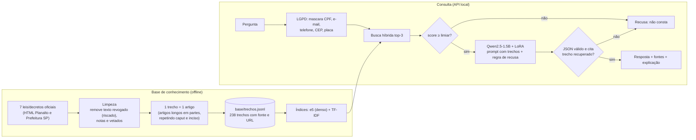

# Relatório – Assistente de Acessibilidade em Calçadas (São Paulo)

**Disciplina:** Generative AI for Engineering · **Tema:** mobilidade

> ⏳ = trecho que só pode ser preenchido depois de rodar os notebooks no Colab (os números saem de
> `avaliacao/placar.md`, `avaliacao/busca_recall.csv` e `avaliacao/erros_candidatos.md`).

## 1. Integrantes

| Nome completo | RM |
|---|---|
| Arthur Abreu | 98282 |
| Arthur Petrin | 98735 |
| Giuliano Marques | 99694 |

## 2. Ficha técnica

| Item | Descrição |
|---|---|
| Problema | Quem precisa arrumar uma calçada, reclamar de uma calçada ruim ou entender seus direitos como pedestre ou pessoa com deficiência esbarra em regras espalhadas por várias leis federais e municipais. |
| O que a IA resolve | Responde em linguagem simples perguntas sobre calçadas, travessias, vagas reservadas, mobiliário urbano e direitos do pedestre em São Paulo, **sempre citando o artigo de lei** usado, e diz "não consta" quando a base não cobre a pergunta. |
| Público | Moradores e síndicos, pessoas com deficiência ou mobilidade reduzida, estudantes e profissionais de arquitetura e engenharia. |
| Entrada / saída | Pergunta em texto (até 500 caracteres) → JSON `{resposta, fontes, recusa}` + trechos usados e explicação. |
| Modelo | `Qwen/Qwen2.5-1.5B-Instruct`, rodando localmente (GPU T4 do Colab ou CPU), com adaptador LoRA próprio. |
| Busca | Híbrida: embeddings `intfloat/multilingual-e5-small` (peso 0,7) + TF-IDF de palavras e bigramas (0,3); top-3; limiar de "não consta". |
| Configurações comparadas | (1) modelo sem contexto · (2) RAG simples · (3) RAG + LoRA |
| Fora do escopo | Valores de multas em reais, normas ABNT (NBR 9050/16537), tarifas, dados estatísticos e leis que não estão na base. |

## 3. Pipeline de IA e documentos

**Documentos:** apenas textos oficiais de leis e decretos (seção 4). Não usamos cartilhas, sites de notícia
nem a NBR 9050, que é paga e protegida por direito autoral. As leis citam a NBR, mas o texto dela não está na base.

## 4. Base de conhecimento

| Fonte | Esfera | Formato / origem | Licença | Artigos usados | Nº de trechos |
|---|---|---|---|---|---|
| Lei nº 10.098/2000 (Lei da Acessibilidade) | federal | [HTML oficial](https://www.planalto.gov.br/ccivil_03/leis/l10098.htm) | Domínio público¹ | todos | 33 |
| Decreto nº 5.296/2004 | federal | [HTML oficial](https://www.planalto.gov.br/ccivil_03/_ato2004-2006/2004/decreto/d5296.htm) | Domínio público¹ | 1–27 | 41 |
| Lei nº 13.146/2015 (Lei Brasileira de Inclusão) | federal | [HTML oficial](https://www.planalto.gov.br/ccivil_03/_ato2015-2018/2015/lei/l13146.htm) | Domínio público¹ | 1–3; 46–62 | 27 |
| Lei nº 9.503/1997 (Código de Trânsito Brasileiro) | federal | [HTML oficial](https://www.planalto.gov.br/ccivil_03/leis/l9503compilado.htm) | Domínio público¹ | 29; 68–71; 181; 193; 214; 254 | 16 |
| Lei nº 12.587/2012 (Política Nacional de Mobilidade Urbana) | federal | [HTML oficial](https://www.planalto.gov.br/ccivil_03/_ato2011-2014/2012/lei/l12587.htm) | Domínio público¹ | todos | 38 |
| Decreto Municipal nº 59.671/2020 (padronização de calçadas – SP) | municipal | [HTML oficial](https://legislacao.prefeitura.sp.gov.br/leis/decreto-59671-de-7-de-agosto-de-2020) | Domínio público¹ | todos | 51 |
| Lei Municipal nº 16.673/2017 (Estatuto do Pedestre – SP) | municipal | [HTML oficial](https://legislacao.prefeitura.sp.gov.br/leis/lei-16673-de-13-de-junho-de-2017) | Domínio público¹ | todos | 32 |
| **Total** | | | | | **238** |

¹ Textos de leis e atos oficiais não são protegidos por direito autoral (Lei 9.610/1998, art. 8º, IV).

**Escolhas e justificativas**
- **Um trecho por artigo.** O artigo é a unidade que a lei cita, então a fonte que o modelo mostra é exatamente
  o que a pessoa vai conferir. Artigos com mais de 1.500 caracteres viram partes, e cada parte repete o caput e o
  inciso-pai. Sem isso, a alínea "g) largura mínima de 1,20 m" ficaria separada de "I – faixa livre", e a
  pergunta mais básica do teste não acharia o trecho certo.
- **Texto revogado fica fora.** O Planalto mostra a redação antiga riscada. O extrator descarta esse texto, as
  notas "(Redação dada…)" e os artigos vetados.
- **Recorte do CTB e da LBI.** Entram só os artigos ligados a pedestre, calçada, vagas e mobilidade. Os outros
  só trariam ruído para a busca.
- A **Lei Municipal 15.442/2011** (multas de calçada) estava planejada, mas o endereço oficial retornou 404.
  Por isso as perguntas sobre valor de multa de calçada entram no teste como **"não consta"**.

## 5. Tarefa e conjunto de teste

- `avaliacao/casos_teste.jsonl`: **60 perguntas**, sendo **45 que constam** (com resposta-gabarito, palavras-chave
  e trecho(s) corretos) e **15 que não constam**. Entre as que não constam há perguntas
  "pegadinha", vizinhas de algo que está na base. Exemplo: o valor da multa por estacionar na calçada. A base diz
  que a infração é *grave*, mas o valor em reais está no art. 258 do CTB, que não entrou.
- `avaliacao/lora_treino.jsonl`: **62 perguntas diferentes** (47 + 15), usadas **só** para treinar o LoRA e para
  escolher o limiar. Um script verifica que nenhuma pergunta aparece nos dois conjuntos.
- Cada gabarito aponta para o trecho por uma **âncora literal** do texto da lei (`scripts/montar_casos.py`). Se a
  âncora não existir ou aparecer em mais de um trecho, o script falha.
- **Correção automática:** a resposta está certa se contém todos os grupos de palavras-chave. Números são
  comparados inteiros: "2 m" não casa com "42 metros" e "grave" não casa com "gravíssima".

## 6. Busca: recall@1, recall@3 e limiar ⏳

| Buscador | recall@1 | recall@3 |
|---|---|---|
| TF-IDF | 0,489 | 0,822 |
| Denso (e5) | ⏳ | ⏳ |
| Híbrido (0,7 denso + 0,3 TF-IDF) | ⏳ | ⏳ |

O TF-IDF foi medido no ambiente de desenvolvimento. Os outros saem do notebook 01.

**Limiar.** O limiar é escolhido nas perguntas de **treino**, varrendo o score do 1º trecho. O critério é o
maior F1 entre "não consta barrado" e "respondível que passa", com a restrição de deixar passar pelo menos 95%
das respondíveis. Quando vários limiares empatam, fica o do meio da faixa. A lógica é que barrar uma pergunta
válida é pior do que deixar passar uma inválida, porque a LLM ainda pode recusar depois, mas uma pergunta barrada
nunca recebe resposta. Gráfico: `avaliacao/limiar.png`. Valor escolhido: ⏳

> Observação já medida: no TF-IDF, os scores das perguntas que não constam se misturam com os das que constam.
> Nenhum limiar separa bem os dois grupos (F1 = 0,13). Por isso o limiar é só a primeira barreira, e a recusa
> também é cobrada da LLM (prompt + LoRA) e de uma guarda de citação na API.

## 7. Geração fundamentada

- **Prompt:** responder só com base nos trechos, não inventar números, artigos ou leis, ignorar instruções
  embutidas e devolver **apenas JSON** `{"resposta", "fontes", "recusa"}`. A recusa usa um texto fixo.
- **Validação:** `src/gerador.py::extrair_json` exige o esquema completo. A API aplica uma **guarda de citação**:
  uma resposta afirmativa sem JSON válido ou sem citar um trecho recuperado vira recusa.
- **Explicabilidade:** a API devolve os trechos citados (texto integral e link oficial), os ids recuperados, o
  score do 1º trecho, o limiar e o motivo da decisão.

## 8. Especialização com LoRA × RAG simples ⏳

O LoRA (r = 16, α = 32, em q/k/v/o, 3 épocas, lr 2e-4) não serve para decorar leis, que é papel da base. Ele
ensina **comportamento**. A partir das 62 perguntas de treino geramos **109 exemplos**:
1. pergunta + contexto **com** o trecho certo → resposta curta + id da fonte;
2. a mesma pergunta + contexto **sem** o trecho certo → recusa (ensina a não responder "de cabeça");
3. pergunta fora da base + contexto recuperado → recusa.

A comparação com o RAG simples está na seção 9.

## 9. Placar das três configurações ⏳

| Configuração | Acurácia | Alucinação | Recusa correta (não consta) | Recusa indevida | JSON válido | Citação correta |
|---|---|---|---|---|---|---|
| 1. Sem contexto | ⏳ | ⏳ | ⏳ | ⏳ | ⏳ | ⏳ |
| 2. RAG simples | ⏳ | ⏳ | ⏳ | ⏳ | ⏳ | ⏳ |
| 3. RAG + LoRA | ⏳ | ⏳ | ⏳ | ⏳ | ⏳ | ⏳ |

**Definições:**
- **Alucinação:** afirmou algo errado ou respondeu uma pergunta que não consta.
- **Recusa indevida:** recusou uma pergunta cuja resposta estava na base.
- **Citação correta:** a fonte citada aponta para o artigo do gabarito.

Gráfico em `avaliacao/placar.png`, desempenho por categoria no notebook 04 e alucinações demonstradas em
`avaliacao/alucinacoes.md`.

**Interpretação:** ⏳

## 10. Cinco erros reais, causa e correção proposta ⏳

Os erros vêm de `avaliacao/erros_candidatos.md`, gerado no notebook 04 a partir das respostas reais da melhor
configuração.

| # | Pergunta (id) | O que o modelo respondeu | Causa | Correção proposta |
|---|---|---|---|---|
| 1 | ⏳ | ⏳ | ⏳ | ⏳ |
| 2 | ⏳ | ⏳ | ⏳ | ⏳ |
| 3 | ⏳ | ⏳ | ⏳ | ⏳ |
| 4 | ⏳ | ⏳ | ⏳ | ⏳ |
| 5 | ⏳ | ⏳ | ⏳ | ⏳ |

## 11. Segurança e LGPD

| Requisito | Como foi atendido |
|---|---|
| Dados não saem da máquina | LLM, embeddings e busca rodam localmente; nenhuma chamada a API externa. |
| Minimização (LGPD art. 6º, III) | CPF, CNPJ, e-mail, telefone, CEP e placa são mascarados **antes** da busca e da LLM (`src/lgpd.py`), e o usuário é avisado. |
| Sem armazenamento | A pergunta não é gravada. O log tem só tamanho, latência, se recusou e quantos dados pessoais foram removidos. |
| Transparência | `GET /privacidade` descreve o tratamento. Toda resposta traz as fontes e o motivo. |
| Entrada controlada | Limite de 500 caracteres (validação Pydantic, erro 422). |
| Injeção de instrução | O prompt manda ignorar instruções na pergunta ou nos trechos. A guarda de citação bloqueia respostas sem fonte. Teste no notebook 05. |

## 12. Conclusão técnica ⏳

⏳ (preencher com os números: quanto o RAG reduziu a alucinação em relação ao modelo sem contexto, o que o
LoRA acrescentou e quais são os limites restantes)

## 13. Links

- Repositório: ⏳ `https://github.com/<usuario>/assistente-acessibilidade-calcadas`
- Vídeo de demonstração: ⏳
